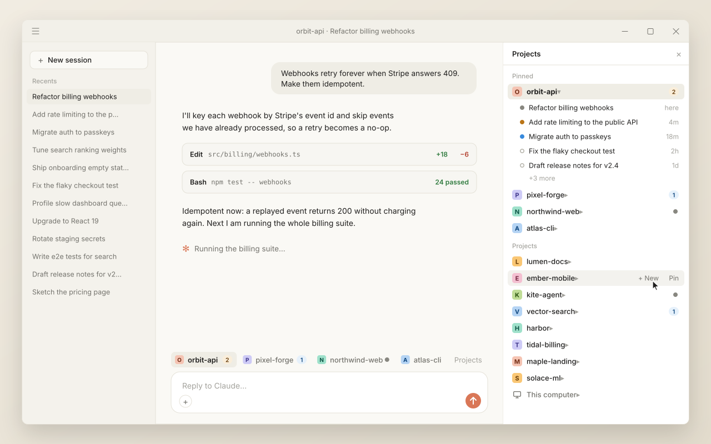
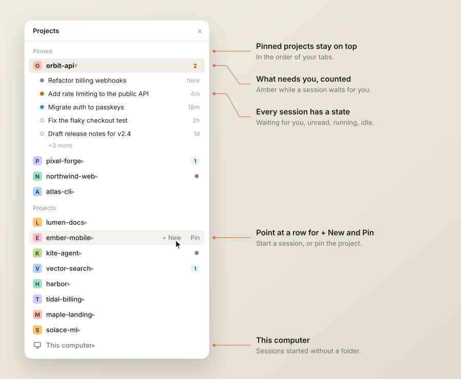
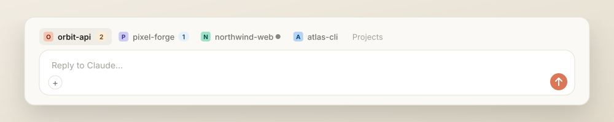

<div align="center">

# env-tabs

### Your projects, pinned in Claude Desktop's Code tab

A **Projects pane** with your pinned projects on top, **live session states** like the sidebar's dots,<br>
and a **tab above the prompt** for every project you pin.

[](#install)
[](#install)
[](#what-it-reads-runs-and-keeps)
[](LICENSE)

<br>

<picture>
  <source media="(prefers-color-scheme: dark)" srcset="docs/images/hero-dark.svg">
  
</picture>

<sub>Demo projects. The pictures are drawn by <a href="docs/demo/render.mjs">docs/demo/render.mjs</a> with the mod's own icons and colors.</sub>

</div>

<br>

## Why

The Code tab's sidebar sorts its folder groups by itself, by recent activity or A to Z, and there is no way to keep the projects you use most at the top. Plenty of people have asked for one, on Windows and on macOS: [#70104](https://github.com/anthropics/claude-code/issues/70104), [#66196](https://github.com/anthropics/claude-code/issues/66196), [#102088](https://github.com/anthropics/claude-code/issues/102088).

Neither a mod nor Claude can pin a folder group in the app's sidebar, so **env-tabs** draws a Projects pane of its own beside the conversation, and tabs above the prompt. Your sessions are not moved or filed anywhere: the app's sidebar stays exactly as it is.

## What you get

### A Projects pane, pinned projects on top

<picture>
  <source media="(prefers-color-scheme: dark)" srcset="docs/images/pane-dark.svg">
  
</picture>

- **Pinned projects stay on top**, in the order of their tabs. Every other recent project follows, the latest first.
- **Every project has an icon**: its first letter on a color of its own, which a rename keeps. The project you are in is highlighted.
- **Click a project** to show or hide its sessions, **click a session** to open it.
- **Point at a project's row** for **+ New**, which starts a session in that folder, and **Pin** or **Unpin**.
- **Projects are folders, like in the sidebar**: a project inside a pinned folder keeps its own row, and a session in one of a repository's worktrees is listed under the repository.
- **This computer** gathers the sessions you started without choosing a folder.

### Session states, like the sidebar's dots

| | State | What it means |
| :---: | --- | --- |
|  | **Waiting for you** | The session needs a permission or an answer. |
|  | **Unread** | It finished after you last looked at it. |
|  | **Running** | Claude is working; the dot pulses. |
|  | **Idle** | Nothing new. |

A project's row and its tab **count the sessions that need you**: the ones waiting for you or unread, in amber while one waits. A project with a session running and nothing to count shows the running dot. The states refresh every few seconds, and the session you are in is never shown as unread.

### A tab above the prompt for every pinned project

<picture>
  <source media="(prefers-color-scheme: dark)" srcset="docs/images/tabs-dark.svg">
  
</picture>

- **One click opens the project's latest session**, or starts one in its folder when it has none yet.
- The tab of the project you are in is filled, and every tab carries the project's icon and its count.
- In a project you have not pinned, **+ Pin this folder** pins it right there; **Projects** opens the pane.

## Install

At the prompt of a terminal session:

```
/plugin install env-tabs --marketplace ahmtsahin/claude-env-tabs
```

Or from a shell:

```
claude plugin install env-tabs --marketplace ahmtsahin/claude-env-tabs
```

Answer `y` to add the marketplace and pick the **user** scope, so the pane and the tabs show in every session.

In the desktop app, where `/plugin` does not run: click **+** next to the prompt box, then **Plugins**, **Add marketplace** with `ahmtsahin/claude-env-tabs`, then **Add plugin**.

> [!NOTE]
> Requires Claude Desktop with mod support. Built and tested on Windows 11 with Claude Desktop (Claude Code engine 2.1.299). macOS runs the same code, opening sessions with `open` instead of `rundll32` and reading the session states from `~/Library/Application Support/Claude`; the tests cover both, but it has not been tried on a Mac yet.

## Use

- **The pane opens by itself** when the window has room beside the conversation. Otherwise click **Projects** above the prompt, or run `/env-tabs panel`. Close it and it stays closed in later sessions until you open it again.
- **Pin a project** with **Pin** on its row in the pane, or **+ Pin this folder** above the prompt in one of its sessions.
- **Or just ask Claude**: *"pin this project"*, *"move orbit-api to the first tab"*, *"unpin lumen-docs"*.
- **Or use the command**:

| Command | What it does |
| --- | --- |
| `/env-tabs` | Lists the pinned projects |
| `/env-tabs pin [folder]` | Pins this session's project, or the folder given |
| `/env-tabs unpin <n>` | Unpins tab `n` (or the tab with that label) |
| `/env-tabs move <n> <to>` | Moves tab `n` to position `to`, in the pane too |
| `/env-tabs rename <n> <label>` | Renames tab `n` and its project in the pane |
| `/env-tabs panel` | Opens the Projects pane |
| `/env-tabs status` | Shows what env-tabs sees, and where it reads the states from |

## Good to know

- **Projects are folders.** A session is listed under the folder it runs in, as in the sidebar, so pinning `D:\Code` does not gather `D:\Code\api` under it. Pin that one too.
- **This computer.** A session started without a folder runs in a scratch folder the app makes for it. The pane lists all of them in one row at the bottom of Projects; there is no folder to start a session in or to pin, so that row has no **+ New** or **Pin**.
- **Recent sessions only.** env-tabs reads your 60 most recent sessions, since the app caps the session list it hands to a mod. A project with no session among them is listed once you pin it, and the pane shows up to 5 sessions per project.
- **New sessions.** **+ New** and a tab with no session open the app's documented link, `claude://code/new?folder=...`. The app asks you to confirm the folder each time (**Trust workspace**), since it does not trust a folder that comes from a link. Now and then it still starts the session in a new scratch folder; its Environment card then shows **Choose folder…**, so choose the folder there before you send the first message.
- **Per computer.** Pins are kept on the computer where you made them.

## What it reads, runs and keeps

Everything stays on your computer: env-tabs makes **no network requests**.

| | What | Why |
| --- | --- | --- |
| **Reads** | The app's session list, through the app's own local tools | The projects and their sessions |
| **Reads** | Each running session's file in `~/.claude/sessions` | Busy, idle, or waiting for you |
| **Reads** | The desktop's record of each session | When you last looked at it, when it last did something |
| **Runs** | `rundll32 url.dll,FileProtocolHandler claude://…` on Windows, `open claude://…` on macOS | Opening a session, or starting one in a folder |
| **Keeps** | Your pins, and which projects you folded, in the plugin's own store | So they are there in the next session |

## Develop

```
claude plugin validate .
claude plugin test .
```

To run a working copy, start a session with `claude --plugin-dir <this folder>`, or name the folder in `CLAUDE_CODE_PLUGIN_DIRS`. The pictures in this README are drawn by `node docs/demo/render.mjs`.

Issues and pull requests are welcome.

<br>

<div align="center">

**If env-tabs saves you a few clicks a day, a ⭐ helps other people find it.**

[MIT](LICENSE)

</div>
